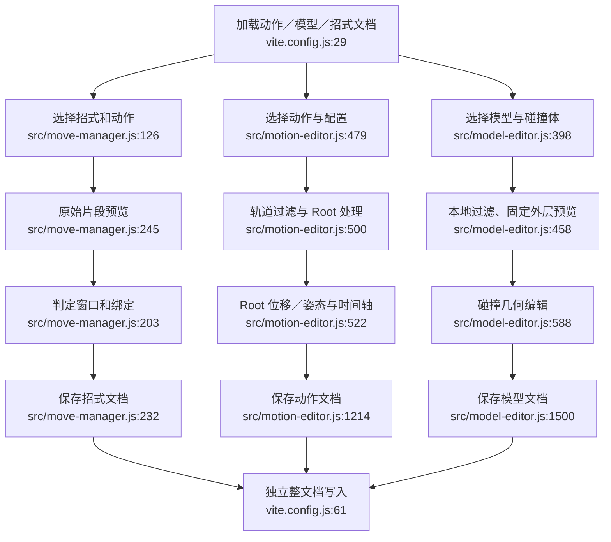

# 编辑与预览现状

三个编辑器共用 Three.js 和 GLTFLoader，但预览语义不同：招式预览直接播放原片段；动作预览积分 Root Motion；模型预览固定外层，仅应用自己的轨道过滤。

循环和播放速度也不同：招式预览总循环且按 1 倍时间推进；模型预览读取保存的循环设置；动作预览有独立预览循环状态和目标速度换算。

副作用：草稿／脏标记、预览 mixer、碰撞网格，及三个不同配置文件的整文档保存。当前 API 只检查顶层对象形状，没有跨文件引用和版本检查。

依据：`src/move-manager.js:117–154,203–255`；`src/motion-editor.js:479–574,1196–1236,1359–1379,1531–1738`；`src/model-editor.js:398–549,1500–1521,1621–1707`；`vite.config.js:53–148`。

本图保留编辑工具的不同职责；不建议把交互界面与所有保存文件合为一个模块。
