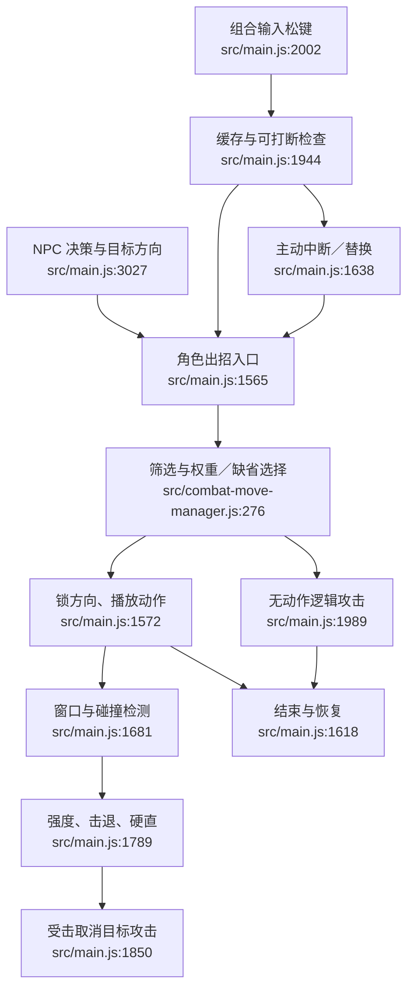

# 战斗执行现状

玩家输入与 NPC 的目标计算是合理差异。两者共用角色出招入口，但动作完成、命中调用、冷却和返回值处理分别维护。

副作用：动画播放与混合、角色位置／朝向、攻击缓存和命中记录变化。无动作逻辑攻击没有命中效果；NPC 自身冷却仍应归 AI 调度。

依据：`src/main.js:1536–1665,1681–1911,1944–2093,3027–3098,3363–3415`；`src/combat-controls.js:1–61`；`src/combat-move-manager.js:246–283`。

静态核对，不代替逐动画、逐碰撞的运行时验证。
