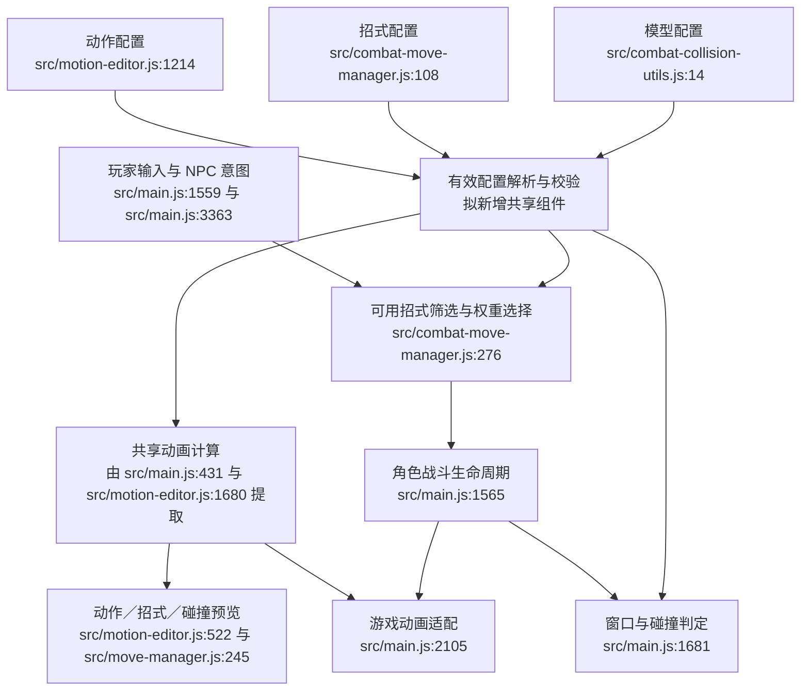

# 优化建议

## 总体判断

保留动作、招式、模型三类配置，通过共享动画计算和联动编辑减少重复调试。近期不引入通用技能 DSL、不合并为一个巨型 JSON，也不重建整个状态机。

## 第一阶段：预览一致与配置可解释

### 共享动画计算

- 从 `src/main.js:431`、`:455`、`:576`、`:779` 和 `src/motion-editor.js:1531`、`:1680` 提取已重复的采样、轨道过滤和 Root 位移／姿态计算。
- 动作编辑器、招式编辑器、模型编辑器和游戏调用同一组计算；界面、时间推进、碰撞阻挡和动作混合上下文由各入口提供。
- 招式编辑器 `src/move-manager.js:245` 接入处理后的动画和世界位移，不再只播放原始片段。
- 不能把离线任意时间采样与运行时增量推进硬合成同一个循环；共享数学语义，保留必要的适配。
- 回归同一动作在多个时刻的 Root／骨骼坐标，再验证动作切换。尤其保留运行时姿态锚点和编辑器初始姿态的合理差异。

### 最终生效配置

- 提供一个解析入口，合并统一默认值与动作配置，再应用明确的战斗用途约束；界面能显示原始值与最终生效值及来源。
- 例：当前攻击在游戏中强制单次播放；编辑器的循环预览属于调试选项，名称与保存值应分清。
- 统一播放速度边界：当前动作预览下限是 0.5，而游戏存在下限为 0 的路径，应先对齐语义与迁移策略。
- 高级 Root、脚锁、姿态参数保留在折叠区；预设只提供初始值，不在后台持续覆盖用户微调。
- 已有动作默认可打断区间保留；只有实际出现同一动作的不同招式需不同取消时机时，再加入招式覆盖，并明确“继承／覆盖”。

## 第二阶段：招式工作流

### 联动入口和时间轴

- 以招式页面为工作入口，能定位对应动作、模型碰撞体及其配置来源；保留各独立编辑器。
- 一条时间轴显示攻击判定段与动作可打断段，允许拖拽和精确输入。可打断段仍写回动作配置，判定段仍写回招式配置；明确保存目标。
- 时间轴提供动画进度与片段秒数；硬直时间属于命中后的游戏时长，另行显示，避免和攻击者片段时间混淆。
- 保留多个命中窗口、每模型绑定、自定义击退角度、无受击动画硬直、无动作方向箭头。
- 临时预览可以叠加未保存草稿，但提交前统一校验；不把预览草稿自动保存为配置。

### 招式定义和方向使用关系

- 近期先为现有结构建立明确的唯一归属规则，校验方向组与 `triggerDirection` 一致，并统一方向定义的来源。
- 随同一招式复用需求增长，再迁移为“一份招式定义 + 方向池引用”。强度、动作、判定只维护一次；方向池保留各自权重和缺省项。
- 不把左右类现有招式仅凭文件名自动迁移到左后／右后，迁移必须保持当前已调试行为。
- 角色体系未来只返回当前可用招式集合；NPC 和玩家仍走同一方向池与权重选择。角色条件不写进动画处理函数。

## 第三阶段：数据校验与内部维护

- 加载／保存时归一化，建立按 ID／方向查找的索引；改变草稿或重新加载时重建索引，避免每次命中都重新归一化全表。
- 校验动作资源、动作配置、模型、碰撞体 ID、attack 通道、窗口越界、缺省 ID、重复 ID；区分合法空方向提示与真正错误。
- 编辑器和保存 API 使用同一校验，避免只依赖 UI；保存可增加文件版本检查，防止多个窗口覆盖旧副本。
- 重构 `src/main.js:1565` 的战斗生命周期为少量可直接导入的函数，保留玩家／NPC 调度差异；不用抽象工厂替代现有简单分支。
- 删除 `src/main.js:2696` 中 return 后的旧移动代码，核查未使用的旧方向函数；长行编辑器按加载、预览、时间轴、表单和保存拆清职责。
- 回归测试直接导入共享模块，逐步替换 `tools/test_combat_controls.mjs:89` 的 AST 提取与 VM 装配；现有测试先保留作为迁移保护。

## 建议的统一数据流

下图为提案。新增组件未实施，不标造假的源代码行号。

优先做第一阶段的一致性、有效配置与校验；方向池数据迁移和完整角色技能体系可后置。当前招式数量较少，运行时索引主要是结构清晰性的优化，不应宣传为已测得的性能瓶颈。
